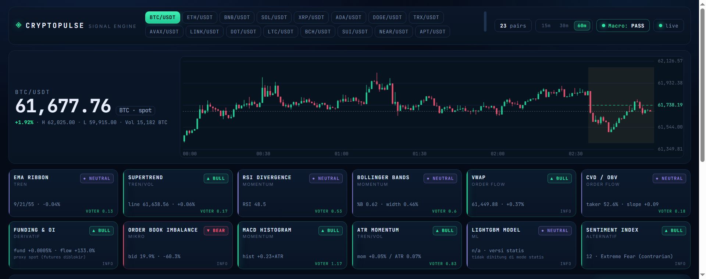

# CryptoPulse

**Live:** https://iankesuma.github.io/cryptopulse/ · **Repo:** https://github.com/iankesuma/cryptopulse



Dashboard sinyal + prediksi harga (23 instrumen crypto & emas XAUT), semua indikator
dihitung sendiri dari data Binance publik. Ada dua bentuk:

| versi | isi | jalankan |
|---|---|---|
| **Statis** (`docs/`) | 12 indikator dihitung di browser, data langsung dari Binance (REST+WS), ML = regresi logistik dilatih in-browser (AUC ~0.45, info-only), riwayat prediksi di localStorage. Ini yang jalan di GitHub Pages. | buka URL live, atau `cd docs && python -m http.server 8100` |
| **Python** (`app.py`) | sama + LightGBM asli + SQLite + WebSocket hub sendiri. Untuk lokal/backend. | `python app.py --open` → http://127.0.0.1:8099 |

Dashboard sinyal + prediksi harga kripto live, dibuat mirip tampilan bot di video
(10 panel indikator, ringkasan sinyal, panel prediksi 15 menit). Semua angka
dihitung dari data pasar asli Binance — tidak ada angka hardcode.

**Lokal (versi Python):** http://127.0.0.1:8099

## Jalanin

```bash
# cara cepat (Windows)
start.bat

# manual
cd C:\Users\Evaluation Software\Projects\cryptopulse
python app.py --open        # --open = langsung buka browser
```

Butuh: `fastapi`, `uvicorn`, `websockets`, `numpy`, `lightgbm`.
Kalau ada yang hilang: `python -m pip install fastapi uvicorn websockets numpy lightgbm`

Port lain: `CRYPTOPULSE_PORT=8123 python app.py`

## Instrumen (23)

**Crypto (Binance USDT, 22):** BTC, ETH, BNB, SOL, XRP, ADA, DOGE, TRX, AVAX, LINK, DOT,
LTC, BCH, SUI, NEAR, APT, ATOM, UNI, INJ, HBAR, XLM, ARB

**Gold:** XAUT/USDT (Tether Gold di Binance spot — harga mengikuti XAU/USD, tapi punya
order book + volume asli). Sebelumnya pakai XAU/USD dari gold-api/Twelve Data; diganti
karena XAUT memberi depth & volume nyata sehingga 10 panel semuanya terisi.

Tambah/hapus cukup edit `INSTRUMENTS` di `engine.py` (field `source`: `binance` atau `gold`).
Cek dulu status pair di `https://data-api.binance.vision/api/v3/exchangeInfo` — pair yang
`status: BREAK` (mis. TONUSDT) akan gagal bootstrap.

## Sumber data (semua live)

| Data | Sumber |
|---|---|
| Crypto: harga, klines 1m, 24h ticker | `data-api.binance.vision` (REST) |
| Crypto: stream realtime kline + order book depth20@1000ms | `wss://data-stream.binance.vision` |
| XAU/USD: tick harga tiap 5 detik | `api.gold-api.com/price/XAU` (tanpa API key) |
| XAU/USD: OHLC 1m (480 bar, refresh 5 menit) | Twelve Data `time_series` (API key di `engine.py`) |
| Fear & Greed index (global) | `api.alternative.me/fng` |

`api.binance.com` dan `fapi.binance.com` diblokir dari mesin ini, jadi dipakai
mirror market-data resmi Binance (`data-*.binance.vision`). Endpoint futures
(funding rate / open interest asli) tidak tersedia → panel **FUNDING & OI**
memakai **proxy dari data spot** (rasio taker buy + ekspansi volume) dan diberi
label "proxy spot" di kartunya.

XAU/USD tidak ada di Binance spot: harga live dari gold-api.com, candle 1m dari
Twelve Data (kuota basic 8 req/menit — 800/hari; app pakai ~288/hari). Karena
gold tidak punya order book & volume per-tick, panel **ORDER BOOK IMBALANCE** dan
**FUNDING & OI** tampil `n/a` untuk XAU/USD, dan volume dihitung 1 per tick
(dipakai VWAP/OBV, bukan volume kontrak asli).

## 10 indikator (semua dihitung sendiri)

| # | Panel | Indikator | Kategori |
|---|---|---|---|
| 1 | EMA RIBBON | EMA 9/21/55 + posisi harga vs EMA21 | Tren |
| 2 | SUPERTREND | ATR(10) × 3, arah flip | Tren/Vol |
| 3 | RSI DIVERGENCE | RSI14 + deteksi pivot low/high (divergence) | Momentum |
| 4 | BOLLINGER BANDS | BB 20/2, %B, squeeze | Momentum |
| 5 | VWAP | VWAP sesi (mulai 00:00 UTC) + deviasi | Order Flow |
| 6 | CVD / OBV | volume delta taker (2·takerBuy − vol) + slope OBV | Order Flow |
| 7 | FUNDING & OI | proxy spot: funding estimasi + flow volume | Derivatif |
| 8 | ORDER BOOK IMBALANCE | total bid vs ask dari depth20 realtime | Mikro |
| 9 | LIGHTGBM MODEL | LightGBM binary classifier: P(harga naik 15 menit) — dilatih ulang tiap 4 menit dari 1000 kline 1m | ML |
| 10 | SENTIMENT INDEX | Fear & Greed (ekstrem dipakai contrarian) | Alternatif |
| 11 | MACD HISTOGRAM | (EMA12−EMA26) − EMA9, dinormalisasi ATR — IC +0.098 @60m | Momentum |
| 12 | ATR MOMENTUM | return 10 bar / (3 × ATR%) — IC +0.069 @60m | Tren/Vol |

Bobot tiap sinyal ada di `PRIORS` (`engine.py`). Skor agregat ∈ [−1, 1]:

**Bobot = bukti, bukan selera.** Hasil audit (`audit/REPORT.md`) dipakai langsung:

- `bobot = |IC| × 12` (cap 1.8), `arah = sign(IC)` per horizon, dari tabel `ic_table.json`
- aturan dengan |IC| < 0.010 otomatis **info-only** (tampil, bobot 0)
- bobot bisa diskalakan IC pair itu sendiri (±0.35–1.3×) tapi **tidak boleh membalik arah**
- LightGBM: AUC out-of-sample 0.499 → info-only (bukan voter)

**Horizon menentukan segalanya.** Default **60 menit**, bisa diganti 5/15/30/60 di header:

| horizon | temuan audit | perilaku app |
|---|---|---|
| 5m | semua indikator IC negatif, kontrarian pun cuma 49.5% | hampir selalu WAIT (ambang 0.25) |
| 15m | momentum 46.5% (salah arah), kontrarian 51.2% tapi edge 0.004% | voter kontrarian, ambang 0.22 → mayoritas WAIT |
| 30m | campuran, IC kecil positif | ambang 0.18 |
| 60m | MACD+ATR-momentum: hit 51.6%, edge +0.109% (net +0.009% setelah fee) | mode utama |

**Gate sinyal:** `|skor| > ambang` **dan** ≥2 dari 3 keluarga (tren / momentum / flow)
sepakat **dan** filter rezim lolos (tren 15m & 1h searah, ATR% 0.005–0.9). Kalau gagal →
WAIT dengan alasan tertulis, plus angka backtest + edge setelah fee ditampilkan di UI.

## Prediksi 15 menit

```
sigma      = ATR(1m, 14) × √15
target     = harga + skor × sigma × 1.35
band       = sigma × (1.05 + 0.45 × (1 − |skor|)) × faktor_volatilitas
confidence = 34 + 26×|skor| + 18×(kategori sepakat/3) + 8×kualitas_IC   (clamp 30–86%)
expected   = skor × sigma × 0.9   (sebelumnya 1.35 — dikurangi karena IC rendah)
```

Setiap prediksi ber-arah dicatat ke SQLite (`data/cryptopulse.db`) dan
di-resolve otomatis 15 menit kemudian dengan harga penutupan candle 1m →
hit rate di panel "AKURASI PREDIKSI" itu hasil nyata, bukan hiasan.
Prediksi berkondisi WAIT tidak dicatat (bukan prediksi).

## Cold start

23 instrumen × (1000 kline + latih LightGBM) ≈ 30–45 detik. Jangan buka browser
sebelum `[boot]` semua simbol selesai, atau halaman tampil kosong/refused.

## Struktur

```
cryptopulse/
  app.py            FastAPI: REST + WebSocket hub + client Binance WS
  engine.py         sinyal, agregasi, prediksi, model LightGBM, SQLite
  indicators.py     EMA/ATR/RSI/BB/SuperTrend/OBV/VWAP/pivot (numpy murni)
  static/index.html layout dashboard
  static/style.css  tema gelap navy + neon green
  static/app.js     live update, render kartu, chart candlestick (canvas)
  data/cryptopulse.db  riwayat prediksi & hit rate
```

## Audit

`audit/REPORT.md` — validasi rumus vs pandas, uji look-ahead, backtest 14 hari × 12
instrumen non-overlapping, uji 13 fitur di 4 horizon, walk-forward LightGBM.
Jalankan ulang: `python audit/run_audit.py` (data cache di `audit/cache/`), probe
kontrarian: `python audit/probe.py`.

## Catatan

Ini alat analisis, bukan jaminan profit. Skor sinyal ≠ hasil trading.
